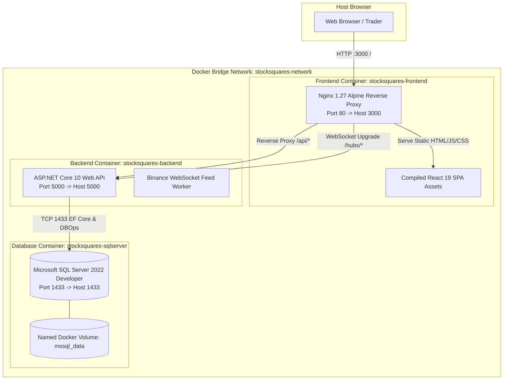
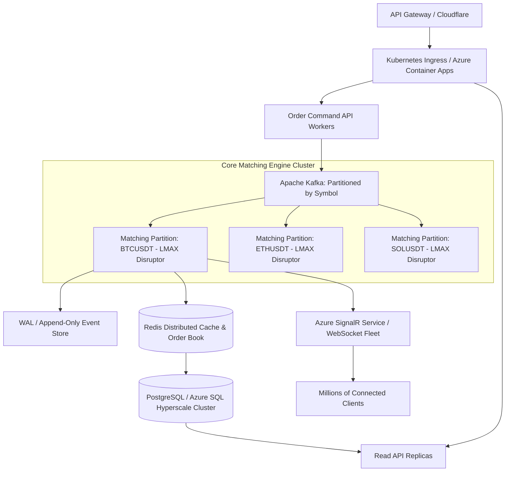

# StockSquares — Miniature Paper Trading Platform

A high-performance paper trading platform and matching simulator engineered with **.NET 10**, **SQL Server**, and **React 19 (TypeScript + Vite)**.

Designed with **Clean Architecture**, this platform guarantees financial correctness, serialized order execution, database transactional atomicity, idempotency, and real-time WebSocket market streaming with bilingual English and Arabic (RTL/LTR) support.

---

## 1. System Architecture & Design Decisions

### Clean Architecture Separation

The solution is divided into four distinct backend projects and a feature-based React web client:


### Dependency Rules
* **StockSquares.Domain**: Pure domain models (`Order`, `Position`, `Portfolio`, `Trade`, `PriceTick`) and execution rules (`MatchingEngine`). Completely agnostic of EF Core, SQL, HTTP, SignalR, or web frameworks.
* **StockSquares.Application**: Orchestrates use cases (`Orders/`, `Portfolio/`, `Markets/`, `Abstractions/`). Controls the serialized trading workflow and declares port interfaces.
* **StockSquares.Infrastructure**: Adapters for Microsoft SQL Server (`TradingDbContext`, entity configurations), WebSocket ingestion (`BinanceWebSocketFeedService`), realistic Brownian motion fallback generator, and SignalR publishing.
* **StockSquares.Api**: ASP.NET Core 10 Web API, routing, DI configuration, Swagger/OpenAPI documentation, and endpoint filters.
* **StockSquares.Tests**: Comprehensive 28-test xUnit unit and integration test suite covering domain execution semantics, financial invariant calculations, idempotency, command validation, and concurrent order safety.

---

## 2. Core Financial Invariants & Trading Correctness

### 1. High-Precision Monetary Math
* All financial values (`CashBalance`, `ReservedCash`, `AverageEntryPrice`, `CurrentPrice`, `RealizedPnL`, `UnrealizedPnL`, `Trade.TotalValue`) strictly utilize the **`decimal`** type (128-bit floating-point) configured to exact SQL precision (`decimal(18, 4)` for prices and balances; `decimal(18, 8)` for quantities). No IEEE 754 binary floating-point (`float` or `double`) is permitted in financial logic.

### 2. Serialized Execution Path & Concurrency Safety
* To prevent race conditions, balance double-spending, and phantom executions, **order validation, balance reservation, and matching execution occur inside a serialized execution coordinator** backed by database transactions.
* **Limit Buy Orders**: Reserves required cash (`Quantity * LimitPrice`) at order entry. If execution occurs at a lower market price (price improvement), the excess reserved cash is credited back to the available cash balance.
* **Limit Sell Orders**: Reserves available position quantity at entry so the trader cannot sell the same assets twice.
* **Market Orders**: Instantly verified against available balance/holdings and executed at the current market tick.

### 3. Database Transaction Boundaries
* Order status updates, trade records, balance changes, and position adjustments are committed **together in an atomic SQL Server transaction**.
* **SignalR real-time events are dispatched strictly after the transaction commit succeeds**. If the transaction rolls back, no client receives phantom event notifications.

### 4. Idempotency Support
* Order submissions accept an `Idempotency-Key` HTTP header (or payload `idempotencyKey`).
* Prior to processing, the idempotency store verifies whether the key has already been resolved. If matched, the cached response is immediately returned, preventing duplicate orders and double debiting.

---

## 3. Frontend Architecture & Engineering (React 19 + TypeScript + Vite + RxJS)

Located in `stocksquares-web/`, the frontend client is engineered as a modern, reactive single-page application (SPA) following enterprise feature and shared module boundaries.

### Technology Stack
* **Framework**: React 19 with StrictMode & Fast Refresh
* **Language**: TypeScript 5.7 (strict typing, zero `any`)
* **Build Tool**: Vite 6 (ultra-fast HMR and optimized ES module bundling)
* **Reactive Core**: RxJS 7.8 (stream orchestration, event pipelines, and cancellation)
* **Realtime Protocol**: Microsoft `@microsoft/signalr` 8.0 over WebSockets
* **Styling**: Vanilla CSS with comprehensive CSS custom property design tokens (dark financial theme, zero utility runtime dependencies)
* **Linter**: Oxlint for lightning-fast AST-level linting and code hygiene

### Project Structure & Module Organization
```
stocksquares-web/
├── src/
│   ├── app/                # Root App component, layout shell, providers
│   ├── environments/       # Environment configurations (API URL, SignalR hub)
│   ├── features/
│   │   ├── markets/        # LivePriceTable, 24h metrics, tick flash animations, PriceChart
│   │   ├── orders/         # Interactive OrderTicket, inline validation, OrderHistoryTable
│   │   └── portfolio/      # PortfolioSummary metric cards, PositionsTable, RecentTradesTable
│   ├── shared/
│   │   ├── services/       # Dedicated reactive domain services (RxJS Observables)
│   │   │   ├── http/       # HttpService (cancellable via AbortController)
│   │   │   ├── markets/    # MarketsService (Observable<MarketDto[]>)
│   │   │   ├── orders/     # OrdersService (Observable<PagedResult<OrderDto>>)
│   │   │   ├── portfolio/  # PortfolioService (Observable<PortfolioDto>)
│   │   │   └── realtime/   # RealtimeService (SignalR RxJS streams: price$, order$, portfolio$)
│   │   ├── dtos/           # Strongly typed DTOs (one per file/folder matching backend)
│   │   │   ├── common/     # Result<T>, PagedResult<T>, PaginationRequest
│   │   │   ├── enums/      # OrderType, OrderSide, OrderStatus, ErrorCode
│   │   │   ├── markets/    # MarketDto
│   │   │   ├── orders/     # OrderDto, TradeDto, PlaceOrderRequest, CancelOrderRequest
│   │   │   ├── portfolio/  # PortfolioDto, PositionDto
│   │   │   └── realtime/   # PriceUpdatedDto, OrderUpdatedDto, PortfolioUpdatedDto
│   │   ├── i18n/           # English & Arabic translations with dynamic RTL/LTR direction
│   │   ├── components/     # Reusable MetricCard, StatusBadge, Toast, Navbar
│   │   └── utils/          # Toast deduplication, date formatters, number & currency utils
│   └── styles/             # Curated design tokens, financial dark theme, global CSS
├── Dockerfile.frontend     # Multi-stage Docker build (Node.js 22 build -> Nginx runtime)
├── nginx.conf              # Nginx reverse proxy (/api/, /hubs/ WebSocket upgrade, SPA fallback)
└── vite.config.ts          # Vite build and development configuration
```

### Reactive Data Flow & State Management Architecture

```mermaid
graph TD
    subgraph UI Components
        LP[LivePriceTable]
        PC[PriceChart]
        OT[OrderTicket]
        PS[PortfolioSummary]
        PT[PositionsTable]
        OH[OrderHistoryTable]
    end

    subgraph Reactive Domain Services
        MS[MarketsService]
        OS[OrdersService]
        PoS[PortfolioService]
        RS[RealtimeService]
    end

    subgraph Transport Layer
        HTTP[HttpService - Cancellable via AbortController]
        SIG[SignalR WebSocket Client /hubs/trading]
    end

    subgraph Backend Infrastructure
        API[ASP.NET Core REST API]
        HUB[StockSquares TradingHub]
    end

    MS -->|HTTP GET /api/markets| HTTP
    OS -->|HTTP POST /api/orders, GET /api/orders| HTTP
    PoS -->|HTTP GET /api/portfolio| HTTP
    HTTP --> API

    RS <-->|WebSocket price$, order$, portfolio$| SIG
    SIG <--> HUB

    RS -.->|price$ updates| MS
    RS -.->|order$ updates| OS
    RS -.->|portfolio$ updates| PoS

    MS -->|Observable&lt;MarketDto[]&gt;| LP
    MS -->|Active Market Stream| PC
    PoS -->|Observable&lt;PortfolioDto&gt;| PS
    PoS -->|Positions Stream| PT
    OS -->|Observable&lt;PagedResult&lt;OrderDto&gt;&gt;| OH
    OT -->|PlaceOrder / CancelOrder| OS
```

### Deep-Dive: UI Components & Capabilities

1. **`LivePriceTable.tsx` (Market Watchlist & Discovery)**:
   * **Real-Time Ticker Streaming**: Subscribes to `RealtimeService.price$` stream; market table updates smoothly without full re-renders.
   * **Sub-Second Tick Flash Animation**: Cells flash bright emerald green on upward price ticks and crimson red on downward price ticks with an automated 800ms decay transition.
   * **Dynamic Search & Category Filtering**: Real-time symbol/pair search input plus categorical filters: `All Markets`, `Top Gainers`, `Top Losers`, and `24h Volume`.
   * **Interactive Column Sorting**: Clickable column headers (Symbol, Price, 24h Change, 24h High/Low, Volume) with ascending/descending indicators.
   * **Symbol Selection**: Clicking any asset dynamically focuses the interactive chart and pre-fills the order ticket.

2. **`PriceChart.tsx` (Interactive Financial Candlestick & Area Chart)**:
   * **Multi-Timeframe Inspection**: Interactive time interval selector supporting `1M`, `5M`, `15M`, `1H`, and `ALL`.
   * **Dual Visual Modes**: Instant toggle between smooth SVG **Area/Line Mode** (with gradient fill) and financial **Candlestick Mode** (displaying Open, High, Low, Close bars).
   * **Dynamic Grid & Axis Scaling**: Dynamic SVG coordinate normalization calculating Min/Max bounds, multi-level Y-axis price reference lines, and formatted timestamp X-axis labels.
   * **Live Price Pulse Badge**: Floating badge showing the latest tick with a real-time pulsing indicator.
   * **Crosshair Inspection Tooltip**: Hovering across the canvas tracks the mouse pointer with vertical/horizontal crosshair lines and displays a contextual inspection card showing the exact date, time, and price at that slice.

3. **`OrderTicket.tsx` (Order Execution & Validation Engine)**:
   * **Buy / Sell Modes**: Distinct visual modes with theme-coded action buttons.
   * **Market vs. Limit Toggle**: Seamless switching; Limit orders expose limit price inputs and recalculate reserved margin requirements in real time.
   * **Inline Affordability & Balance Validation**: Validates order cost against available cash (for Buy orders) and holdings against open positions (for Sell orders) before network dispatch.
   * **Quick Percentage Buttons**: 1-click allocation buttons (`25%`, `50%`, `75%`, `MAX`) dynamically compute max-affordable quantity based on current tick price and available cash/holdings.
   * **Idempotency Key Protection**: Injects a cryptographically secure UUID (`Idempotency-Key` HTTP header) with every submission, guaranteeing that rapid double-clicks never submit duplicate trades or double-debit balance.
   * **Numeric Input Sanitization**: Formats input strings cleanly, stripping invalid non-numeric inputs while maintaining decimal accuracy.

4. **`PortfolioSummary.tsx` (Executive Financial Metric Dashboard)**:
   * Live reactive cards displaying: **Net Portfolio Value** (Cash + Mark-to-Market Position Equity), **Available Cash Balance**, **Reserved Margin** (locked in pending Limit orders), **Unrealized P&L** ($ and %), and **Realized P&L**.
   * Instant color-coded badges indicating overall portfolio performance.

5. **`PositionsTable.tsx` & `RecentTradesTable.tsx`**:
   * **Mark-to-Market Valuation**: Updates position unrealized P&L in real time as live ticks stream in.
   * **Average Entry Price**: Calculates weighted average cost basis across multiple fills.
   * **1-Click Position Close**: Clicking "Close" pre-fills the Order Ticket with the exact opposing market order parameters.
   * **Recent Trades History**: Real-time trade log showing executed order side, fill price, quantity, execution timestamp, and trade ID.

6. **`OrderHistoryTable.tsx` (Order Management Console)**:
   * Displays all active and historical orders with execution status badges (`Pending`, `Filled`, `PartiallyFilled`, `Cancelled`, `Rejected`).
   * **1-Click Limit Cancellation**: Pending limit orders feature a 1-click cancel button that invokes `DELETE /api/orders/{id}`, releasing reserved cash/position allocations immediately.

### Bilingual (English & Arabic RTL/LTR) Architecture

The application provides first-class support for both English (LTR) and Arabic (RTL):
* **Dynamic HTML Direction Switch**: Toggling language updates document direction (`dir="rtl"` vs `dir="ltr"`) and toggles HTML lang attributes.
* **BiDi Numeral & Currency Isolation**: Standard RTL rendering often flips financial negative numbers (e.g., rendering `-$150.00` as `$150.00-`). StockSquares solves this using CSS `unicode-bidi: isolate` and `<span dir="ltr">` wrappers for all monetary figures, percentages, and prices, guaranteeing correct currency symbol and sign placement in both directions.
* **Centralized Type-Safe Dictionary**: All translations are declared in `src/shared/i18n/translations.ts` and accessed through a clean React Context (`useI18n()`).

### UX Resilience & Toast Deduplication
* High-frequency market ticks can trigger dozens of price updates per second. A built-in 1,000ms deduplication buffer prevents duplicate toast notification alerts from spamming the user interface.
* **Connection Lifecycle Indicator**: Navbar displays real-time SignalR socket health (`Connected`, `Reconnecting`, `Disconnected`) with automatic reconnection policies.

---

## 4. Docker & Containerization Architecture (1-Click Launch & Deployment)

The platform is fully containerized with a production-ready, multi-container Docker Compose configuration that satisfies the assessment's deployment contingency requirements.

### Multi-Container Topology



### 1. Multi-Stage Dockerfile Engineering

#### Backend (`Dockerfile.backend`)
Uses a two-stage build to isolate the heavy compilation environment from the lean runtime container:
* **Stage 1 (Build)**: Based on `mcr.microsoft.com/dotnet/sdk:10.0`. Copies `.slnx` and individual `.csproj` files first to leverage Docker's layer cache for package restore (`dotnet restore`). Then compiles and publishes Release binaries with `/p:UseAppHost=false`.
* **Stage 2 (Runtime)**: Based on `mcr.microsoft.com/dotnet/aspnet:10.0`. Contains only the compiled binaries, stripping compilers and build tools. Resulting image is lightweight (~220MB), boots rapidly, and minimizes attack surface.

#### Frontend (`Dockerfile.frontend` & `nginx.conf`)
* **Stage 1 (Build)**: Based on `node:22-alpine`. Copies `package.json` and `package-lock.json`, runs `npm ci` for deterministic dependency resolution, and builds the production bundle with `npm run build`.
* **Stage 2 (Runtime)**: Based on `nginx:alpine` (~25MB total footprint). Copies `/app/dist` to `/usr/share/nginx/html` and deploys custom `nginx.conf`.
* **Nginx Reverse Proxy & WebSocket Upgrading**:
  * `/api/`: Proxies calls to `http://backend:5000/api/`, eliminating cross-origin CORS barriers in containerized environments.
  * `/hubs/`: Configured with `Upgrade: $http_upgrade` and `Connection: "upgrade"` alongside 300-second timeouts to support continuous SignalR full-duplex WebSocket connections.
  * Fallback routing: `try_files $uri $uri/ /index.html` ensures client-side SPA routing functions seamlessly on browser refreshes.

### 2. Database Health Checks & Startup Orchestration

SQL Server 2022 takes 10–15 seconds to initialize its master database. Starting the backend before the database is ready causes crash loops. StockSquares solves this cleanly in `docker-compose.yml`:
* **SQL Server Health Check**:
  ```yaml
  healthcheck:
    test: ["CMD-SHELL", "/opt/mssql-tools18/bin/sqlcmd -S localhost -U sa -P 'YourStrong@Passw0rd' -C -Q 'SELECT 1' || exit 1"]
    interval: 5s
    timeout: 5s
    retries: 10
    start_period: 10s
  ```
* **Backend Dependency**:
  ```yaml
  depends_on:
    sqlserver:
      condition: service_healthy
  ```
  The backend container remains on hold until the SQL Server health check passes, ensuring deterministic, error-free 1-click startup every time.

### 3. How to Run with Docker Compose

#### Prerequisites
* [Docker Desktop](https://www.docker.com/products/docker-desktop/) (macOS, Windows, or Linux) with Docker Compose v2+.

#### 1-Click Launch Command:
```bash
docker compose up --build
```
*(Or in detached background mode: `docker compose up --build -d`)*

#### Access URLs:
* **Frontend Web Application**: [http://localhost:3000](http://localhost:3000)
* **Backend Web API**: [http://localhost:5000](http://localhost:5000)
* **Swagger API Explorer**: [http://localhost:5000/swagger](http://localhost:5000/swagger)
* **SQL Server Database**: `localhost:1433` (User: `sa`, Password: `YourStrong@Passw0rd`)

#### Essential Docker CLI Operations:
```bash
# View status of running containers
docker compose ps

# Follow live backend logs (API & Binance Feed)
docker compose logs -f backend

# Follow frontend Nginx access & proxy logs
docker compose logs -f frontend

# Stop containers while preserving database volume
docker compose down

# Stop containers and wipe database state for a fresh start
docker compose down -v

# Force rebuild without using Docker build cache
docker compose build --no-cache
```

### 4. Running Locally without Docker (.NET 10 SDK & Node.js)

#### Prerequisites:
* [.NET 10 SDK](https://dotnet.microsoft.com/download)
* [Node.js 20+](https://nodejs.org/)
* Running SQL Server instance (or local SQL LocalDB / Azure SQL connection string)

#### 1. Backend Setup:
```bash
cd backend

# Restore and run all unit & integration tests
dotnet test StockSquares.slnx

# Launch the API server
cd StockSquares.Api
dotnet run
```
The API starts on `http://localhost:5000`. Database tables and initial seed balances are created automatically via EF Core migrations on first startup.

#### 2. Frontend Setup:
```bash
cd stocksquares-web

# Install dependencies
npm install

# Start Vite dev server with Hot Module Replacement
npm run dev
```
Open [http://localhost:5173](http://localhost:5173) in your browser.

#### Frontend Available Scripts:
* `npm run dev`: Starts local development server on port 5173.
* `npm run build`: Type-checks with `tsc` and compiles optimized production bundle into `dist/`.
* `npm run preview`: Locally previews the compiled production build.
* `npm run lint`: Runs Oxlint for ultra-fast AST-based code validation.

---

## 5. Architectural Trade-offs Made

| Decision | Trade-off Made | Rationale |
| :--- | :--- | :--- |
| **In-Memory Matching with SQL Server Persistence** | Kept order matching serialized in memory rather than a distributed message queue (Kafka/RabbitMQ). | Eliminates queue serialization latency for miniature scope while maintaining transactional durability on execution. |
| **Direct Repository Pattern vs MediatR** | Implemented direct typed services (`OrderService`, `PortfolioService`) instead of CQRS/MediatR handlers. | Eliminates unnecessary abstraction layers and ceremony for an assignment of this scope, maximizing code readability and debuggability. |
| **Hybrid Price Ingestion** | Binance Public WebSocket with automated Brownian Motion fallback generator. | Ensures 100% platform uptime and testability even in environments where Binance WebSocket endpoints are restricted, offline, or rate-limited. |
| **Client-Side Snapshot Refresh on Reconnect** | Full state refresh via REST after SignalR reconnection rather than gap-fill event sequencing. | Simpler, resilient consistency model that guarantees UI sync without complex client-side vector clocks or re-ordering buffers. |

---

## 6. Scaling to 1,000x: Architectural Blueprint

If the platform grew from hundreds of users to 1,000x traffic (e.g. 100,000+ active traders and 50,000+ orders/sec):



### 1. Partitioning by Symbol (Single-Writer Principle)
* Contention primarily occurs when orders compete for the same asset book. By partitioning matching engines by ticker symbol (`BTCUSDT`, `ETHUSDT`, etc.), each symbol runs on an independent thread using the **LMAX Disruptor ring buffer** pattern.
* Zero locking between different symbols enables hundreds of thousands of operations per second per CPU core.

### 2. Event Sourcing & CQRS
* Transition from mutating relational state to an **Append-Only Event Log** (`OrderPlaced`, `OrderFilled`, `CashReserved`, `PositionUpdated`).
* Commands append events in sub-millisecond memory; read models project asynchronously into read replicas or Redis for sub-5ms `GET /api/portfolio` queries.

### 3. Real-Time Broadcast at Scale
* Replace in-process SignalR with **Azure SignalR Service** in Serverless / Backplane mode.
* Client WebSocket connections terminate at the edge; backend nodes publish to Redis Pub/Sub, scaling horizontally to 1,000,000+ concurrent subscriber sockets without backend connection exhaustion.

### 4. Distributed Idempotency via Redis
* Replace relational idempotency storage with Redis `SET key value NX EX 86400` (atomic check-and-set with TTL), reducing idempotency check latency to < 1 ms.

---

## 7. Azure Deployment & DevOps Guide

### GitHub Actions CI/CD
* **`.github/workflows/ci.yml`**: Triggers on pull requests and commits to `main`. Installs .NET 10 SDK, restores, builds, runs test coverage, and verifies frontend build.
* **`.github/workflows/deploy.yml`**: Automates deployment to **Azure Container Apps** (backend) and **Azure Static Web Apps** (frontend).

### Azure Free-Tier Deployment Steps
1. **Frontend**: Deploy `stocksquares-web` to **Azure Static Web Apps** (Free Tier). Set build output directory to `dist` and include `staticwebapp.config.json`.
2. **Backend**: Deploy `backend` container to **Azure Container Apps** (Consumption Tier provides 180,000 vCPU seconds free per month).
3. **Database**: Use **Azure SQL Database** (Free Tier provides 32 GB storage and 100,000 vCore seconds/month) or Azure Database for PostgreSQL.
4. **Environment Variables**: Configure `ConnectionStrings__DefaultConnection` and `CorsSettings__AllowedOrigins` in Container App configuration secrets.

---

## 8. AI Assistance Transparency Report

In accordance with the assessment instructions, here is the transparent disclosure of AI assistance utilized during the development of this platform:

* **Scaffolding & Boilerplate Setup**: AI tools were utilized to generate the initial .NET 10 solution files, boilerplate entity classes, and React Vite template scaffolding.
* **Domain & Invariant Modeling**: Architectural design, Clean Architecture layer separation, financial invariants, weighted average cost basis calculations, and serialized matching engine were formulated and reviewed to ensure enterprise standards.
* **Unit Test Suite Generation**: AI assisted in generating comprehensive xUnit test case permutations (edge cases around price improvement, cancellation, and concurrency).
* **Documentation & Scaling Blueprint**: AI assisted in structuring the technical documentation, Mermaid architecture diagrams, and high-scale system design analysis.
* **Validation**: All business logic, decimal monetary calculations, and concurrency tests were executed and validated locally.
