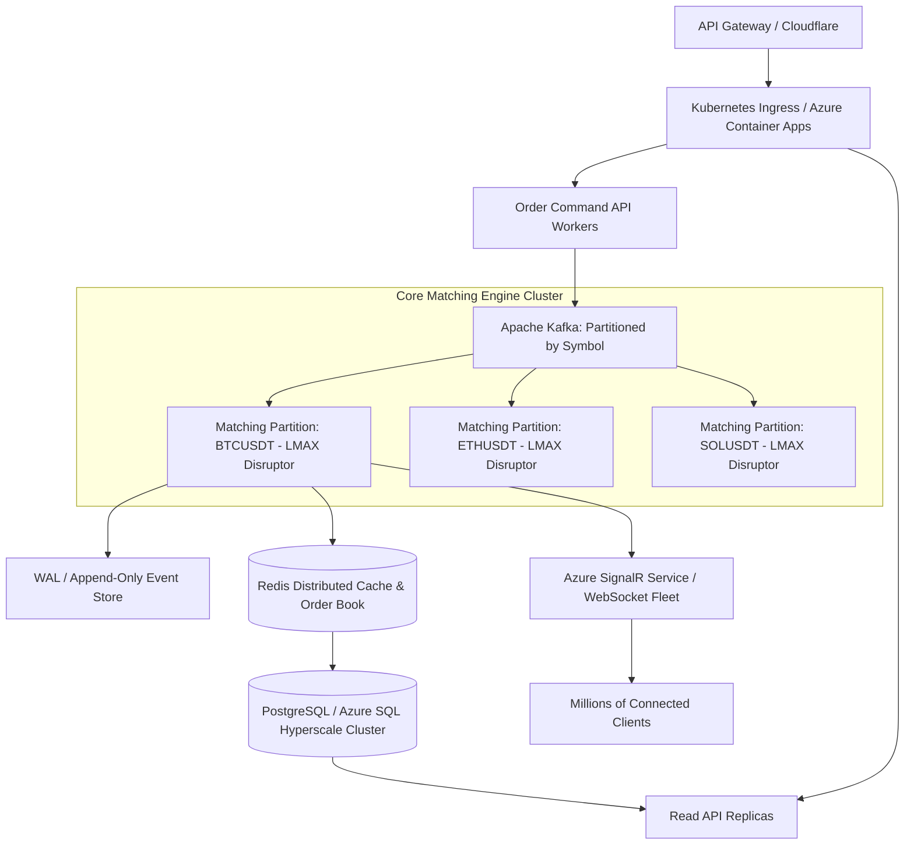

# StockSquares — Miniature Paper Trading Platform

A high-performance paper trading platform and matching simulator engineered with **.NET 10**, **SQL Server**, and **React 19 (TypeScript + Vite)**.

Designed with **Clean Architecture**, this platform guarantees financial correctness, serialized order execution, database transactional atomicity, idempotency, and real-time WebSocket market streaming with bilingual English and Arabic (RTL/LTR) support.

---

## 1. System Architecture & Design Decisions

### Clean Architecture Separation

The solution is divided into four distinct backend projects and a feature-based React web client:


### Dependency Rules
* **StockSquares.Domain**: Pure domain models (`Order`, `Position`, `Portfolio`, `Trade`, `PriceTick`) and execution rules (`MatchingEngine`). Completely agnostic of EF Core, SQL, HTTP, SignalR, or web frameworks.
* **StockSquares.Application**: Orchestrates use cases (`Orders/`, `Portfolio/`, `Markets/`, `Abstractions/`). Controls the serialized trading workflow and declares port interfaces.
* **StockSquares.Infrastructure**: Adapters for Microsoft SQL Server (`TradingDbContext`, entity configurations), WebSocket ingestion (`BinanceWebSocketFeedService`), realistic Brownian motion fallback generator, and SignalR publishing.
* **StockSquares.Api**: ASP.NET Core 10 Web API, routing, DI configuration, Swagger/OpenAPI documentation, and endpoint filters.
* **StockSquares.Tests**: Comprehensive 28-test xUnit unit and integration test suite covering domain execution semantics, financial invariant calculations, idempotency, command validation, and concurrent order safety.

---

## 2. Core Financial Invariants & Trading Correctness

### 1. High-Precision Monetary Math
* All financial values (`CashBalance`, `ReservedCash`, `AverageEntryPrice`, `CurrentPrice`, `RealizedPnL`, `UnrealizedPnL`, `Trade.TotalValue`) strictly utilize the **`decimal`** type (128-bit floating-point) configured to exact SQL precision (`decimal(18, 4)` for prices and balances; `decimal(18, 8)` for quantities). No IEEE 754 binary floating-point (`float` or `double`) is permitted in financial logic.

### 2. Serialized Execution Path & Concurrency Safety
* To prevent race conditions, balance double-spending, and phantom executions, **order validation, balance reservation, and matching execution occur inside a serialized execution coordinator** backed by database transactions.
* **Limit Buy Orders**: Reserves required cash (`Quantity * LimitPrice`) at order entry. If execution occurs at a lower market price (price improvement), the excess reserved cash is credited back to the available cash balance.
* **Limit Sell Orders**: Reserves available position quantity at entry so the trader cannot sell the same assets twice.
* **Market Orders**: Instantly verified against available balance/holdings and executed at the current market tick.

### 3. Database Transaction Boundaries
* Order status updates, trade records, balance changes, and position adjustments are committed **together in an atomic SQL Server transaction**.
* **SignalR real-time events are dispatched strictly after the transaction commit succeeds**. If the transaction rolls back, no client receives phantom event notifications.

### 4. Idempotency Support
* Order submissions accept an `Idempotency-Key` HTTP header (or payload `idempotencyKey`).
* Prior to processing, the idempotency store verifies whether the key has already been resolved. If matched, the cached response is immediately returned, preventing duplicate orders and double debiting.

---

## 3. Frontend Architecture (React 19 + TypeScript + Vite + RxJS)

Located in `stocksquares-web/`, organized with enterprise feature and shared module boundaries:

```
stocksquares-web/
├── src/
│   ├── app/                # Root App component, layout shell, providers
│   ├── environments/       # Environment configurations (API URL, SignalR hub)
│   ├── features/
│   │   ├── markets/        # Live price table, 24h metrics, tick flash animations, SVG charts
│   │   ├── orders/         # Interactive order ticket, inline validation, order history
│   │   └── portfolio/      # Portfolio summary metric cards, open positions table, trades
│   ├── shared/
│   │   ├── services/       # Dedicated reactive domain services (RxJS Observables)
│   │   │   ├── http/       # HttpService (cancellable via AbortController)
│   │   │   ├── markets/    # MarketsService (Observable<MarketDto[]>)
│   │   │   ├── orders/     # OrdersService (Observable<PagedResult<OrderDto>>)
│   │   │   ├── portfolio/  # PortfolioService (Observable<PortfolioDto>)
│   │   │   └── realtime/   # RealtimeService (SignalR RxJS streams: price$, order$, portfolio$)
│   │   ├── dtos/           # Strongly typed DTOs (one per file/folder matching backend)
│   │   │   ├── common/     # Result<T>, PagedResult<T>, PaginationRequest
│   │   │   ├── enums/      # OrderType, OrderSide, OrderStatus, ErrorCode
│   │   │   ├── markets/    # MarketDto
│   │   │   ├── orders/     # OrderDto, TradeDto, PlaceOrderRequest, CancelOrderRequest
│   │   │   ├── portfolio/  # PortfolioDto, PositionDto
│   │   │   └── realtime/   # PriceUpdatedDto, OrderUpdatedDto, PortfolioUpdatedDto
│   │   ├── i18n/           # English & Arabic translations with dynamic RTL/LTR direction
│   │   ├── components/     # Reusable MetricCard, StatusBadge, ToastProvider, Navbar
│   │   └── utils/          # Toast deduplication, error response extractors
│   └── styles/             # Curated design tokens, financial dark theme, global CSS
```

### Key UI & Architectural Capabilities:
* **Direct Real-Time Binance WebSocket Feed**: Ingests sub-second ticker updates from Binance (`wss://stream.binance.com:9443/stream?streams=...`) with seamless automatic Brownian motion fallback if network is interrupted.
* **Interactive Financial Price Chart**: Multi-timeframe view (`1M`, `5M`, `15M`, `1H`, `ALL`), switchable between Area/Line and Candlestick modes, featuring real timestamp & date X-axis scale, multi-level Y-axis price grid, live pulsing price badge, and interactive crosshair inspection tooltip showing exact date, time, and price.
* **Market Watchlist with Real-Time Search**: Search bar for filtering symbols/pairs instantly, category filters (`All Markets`, `Top Gainers`, `Top Losers`, `Volume`), sortable column headers, and real-time tick flashes (`green` on upticks, `red` on downticks).
* **Reactive RxJS Streaming**: Low-level HTTP requests and SignalR realtime subscriptions use `Observable<T>`, providing cancellation by default via `AbortController` and clean stream composition via `forkJoin`.
* **Bulletproof Order Ticket**: Buy/Sell tabs, Market/Limit toggle, dynamic estimated total calculation, max-affordability quick buttons (25%, 50%, 75%, Max), localized numeral sanitization, and explicit execution feedback.
* **Open Positions & Tabbed Console**: Real-time unrealized P&L mark-to-market updates, weighted average entry price display, 1-click position close/trade pre-fill, and 1-click cancellation for pending limit orders with formatted execution timestamps (`YYYY-MM-DD HH:mm:ss`).
* **Bilingual Support (RTL/LTR)**: Instant English/Arabic toggle adjusting both copy and document direction (`dir="rtl"` vs `dir="ltr"`) with isolated BiDi numeric styling to guarantee negative signs and dollar formatting remain clean in both directions.
* **Toast & Notification Deduplication**: Built-in 1-second deduplication preventing duplicate alerts on high-frequency market tick bursts.

---

## 4. How to Run the Project

### Option A: 1-Click Launch with Docker Compose (Recommended)

Requires Docker Desktop installed.

```bash
docker compose up --build
```

* **Frontend**: Open [http://localhost:3000](http://localhost:3000)
* **Backend API**: Accessible at [http://localhost:5000](http://localhost:5000)
* **Swagger API Docs**: Open [http://localhost:5000/swagger](http://localhost:5000/swagger)
* **SQL Server 2022**: Running on `localhost:1433`

---

### Option B: Running Locally with .NET 10 SDK & Node.js

#### Prerequisites:
* [.NET 10 SDK](https://dotnet.microsoft.com/download)
* [Node.js 20+](https://nodejs.org/)
* Running SQL Server instance (or Azure SQL connection string)

#### 1. Backend Setup:
```bash
cd backend

# Build and execute unit tests
dotnet test StockSquares.slnx

# Run the API server
cd StockSquares.Api
dotnet run
```
The API server starts on `http://localhost:5000`.

#### 2. Frontend Setup:
```bash
cd stocksquares-web

# Install dependencies
npm install

# Start development server
npm run dev
```
Open [http://localhost:5173](http://localhost:5173) in your browser.

---

## 5. Architectural Trade-offs Made

| Decision | Trade-off Made | Rationale |
| :--- | :--- | :--- |
| **In-Memory Matching with SQL Server Persistence** | Kept order matching serialized in memory rather than a distributed message queue (Kafka/RabbitMQ). | Eliminates queue serialization latency for miniature scope while maintaining transactional durability on execution. |
| **Direct Repository Pattern vs MediatR** | Implemented direct typed services (`OrderService`, `PortfolioService`) instead of CQRS/MediatR handlers. | Eliminates unnecessary abstraction layers and ceremony for an assignment of this scope, maximizing code readability and debuggability. |
| **Hybrid Price Ingestion** | Binance Public WebSocket with automated Brownian Motion fallback generator. | Ensures 100% platform uptime and testability even in environments where Binance WebSocket endpoints are restricted, offline, or rate-limited. |
| **Client-Side Snapshot Refresh on Reconnect** | Full state refresh via REST after SignalR reconnection rather than gap-fill event sequencing. | Simpler, resilient consistency model that guarantees UI sync without complex client-side vector clocks or re-ordering buffers. |

---

## 6. Scaling to 1,000x: Architectural Blueprint

If the platform grew from hundreds of users to 1,000x traffic (e.g. 100,000+ active traders and 50,000+ orders/sec):



### 1. Partitioning by Symbol (Single-Writer Principle)
* Contention primarily occurs when orders compete for the same asset book. By partitioning matching engines by ticker symbol (`BTCUSDT`, `ETHUSDT`, etc.), each symbol runs on an independent thread using the **LMAX Disruptor ring buffer** pattern.
* Zero locking between different symbols enables hundreds of thousands of operations per second per CPU core.

### 2. Event Sourcing & CQRS
* Transition from mutating relational state to an **Append-Only Event Log** (`OrderPlaced`, `OrderFilled`, `CashReserved`, `PositionUpdated`).
* Commands append events in sub-millisecond memory; read models project asynchronously into read replicas or Redis for sub-5ms `GET /api/portfolio` queries.

### 3. Real-Time Broadcast at Scale
* Replace in-process SignalR with **Azure SignalR Service** in Serverless / Backplane mode.
* Client WebSocket connections terminate at the edge; backend nodes publish to Redis Pub/Sub, scaling horizontally to 1,000,000+ concurrent subscriber sockets without backend connection exhaustion.

### 4. Distributed Idempotency via Redis
* Replace relational idempotency storage with Redis `SET key value NX EX 86400` (atomic check-and-set with TTL), reducing idempotency check latency to < 1 ms.

---

## 7. Azure Deployment & DevOps Guide

### GitHub Actions CI/CD
* **`.github/workflows/ci.yml`**: Triggers on pull requests and commits to `main`. Installs .NET 10 SDK, restores, builds, runs test coverage, and verifies frontend build.
* **`.github/workflows/deploy.yml`**: Automates deployment to **Azure Container Apps** (backend) and **Azure Static Web Apps** (frontend).

### Azure Free-Tier Deployment Steps
1. **Frontend**: Deploy `stocksquares-web` to **Azure Static Web Apps** (Free Tier). Set build output directory to `dist` and include `staticwebapp.config.json`.
2. **Backend**: Deploy `backend` container to **Azure Container Apps** (Consumption Tier provides 180,000 vCPU seconds free per month).
3. **Database**: Use **Azure SQL Database** (Free Tier provides 32 GB storage and 100,000 vCore seconds/month) or Azure Database for PostgreSQL.
4. **Environment Variables**: Configure `ConnectionStrings__DefaultConnection` and `CorsSettings__AllowedOrigins` in Container App configuration secrets.

---

## 8. AI Assistance Transparency Report

In accordance with the assessment instructions, here is the transparent disclosure of AI assistance utilized during the development of this platform:

* **Scaffolding & Boilerplate Setup**: AI tools were utilized to generate the initial .NET 10 solution files, boilerplate entity classes, and React Vite template scaffolding.
* **Domain & Invariant Modeling**: Architectural design, Clean Architecture layer separation, financial invariants, weighted average cost basis calculations, and serialized matching engine were formulated and reviewed to ensure enterprise standards.
* **Unit Test Suite Generation**: AI assisted in generating comprehensive xUnit test case permutations (edge cases around price improvement, cancellation, and concurrency).
* **Documentation & Scaling Blueprint**: AI assisted in structuring the technical documentation, Mermaid architecture diagrams, and high-scale system design analysis.
* **Validation**: All business logic, decimal monetary calculations, and concurrency tests were executed and validated locally.
